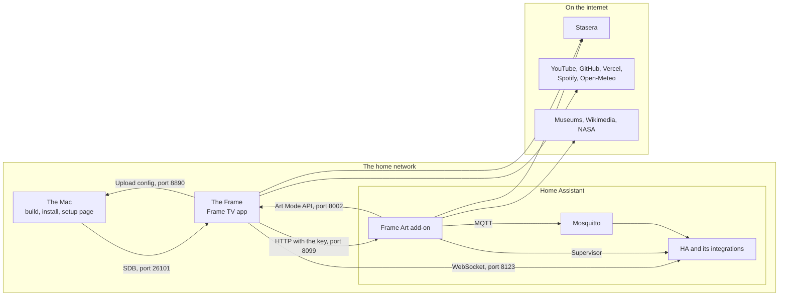

# How it fits together

Four things work together on the wall. Only the first is needed; the rest are added one at a time.

| Part | What it is | Its job |
|---|---|---|
| **Frame TV** (this repo) | A web app installed on the TV | The home screen. It has the screen and the buttons, and it keeps no server of its own |
| **Frame Art** ([eaugum/frame-art](https://github.com/eaugum/frame-art)) | An add-on in Home Assistant | Decides what hangs on the wall in Art Mode |
| **Home Assistant** | The house's own server | The brain: the lights, the automations, and the home of Frame Art |
| **[Stasera](https://www.stasera.app)** | A web service | Provides the data: what you're watching, new episodes, friends, stats and film pictures |

The dividing line matters when you're looking for where something is set: Frame TV never picks a picture for the wall,
and Frame Art never draws the home screen. Frame TV asks Frame Art for Art Mode and a new picture, and Frame Art does
the rest, also when Frame TV isn't running.

## Who calls whom

Everything from the TV goes straight to the service: there's no server of ours in between. That's why the tokens end
up in the app on the TV, and why they should be able to do as little as possible.

## What works with nothing else

Frame TV with an empty `config.properties`:

- **Home** with the greeting, the Apps row, the weather and the clock,
- **TV** with the clock and the apps,
- **All Apps**, the shelf and hidden apps, in the gear,
- the screensaver, Frame TV's own.

The weather comes from Open-Meteo, which needs no key. The TV's time zone gives the city, unless `city` says otherwise.
Stasera is on in the example file, so Home offers to link it; set `stasera=false` if you don't use it.

## What each module adds

| Module | Adds | Needs |
|---|---|---|
| [Stasera](modules.md#stasera) | "Continue Watching", new episodes, the TV rows, search, the title pages, Stats | An account on stasera.app, and the TV linked once |
| [YouTube](modules.md#youtube) | The YouTube tab and a tile on Home | An OAuth client in Google Cloud, and the TV signed in once |
| [GitHub](modules.md#github) | The GitHub tab: commits, languages, projects | A read-only token |
| [Vercel](modules.md#vercel) | The latest deploys, in the GitHub tab | A token |
| [Home Assistant](home-assistant.md) | The Home Assistant tab and tile, notifications on the TV, and what the TV is doing in HA | A long-lived token, and the package for the automations |
| [Spotify](modules.md#spotify) | The Spotify tab and tile, and the controls | An app at Spotify, signed in on the Mac |
| [Art Mode](modules.md#art-mode) | A tile on Home, a button in the tab bar, and Art Mode from the screensaver | The Frame Art add-on in Home Assistant |

A module that is off, or that lacks what it needs, is gone entirely: its tab, tiles and rows, and the rest moves in. Only
its page under the gear → Connections stays, since that's where it's turned on.

Frame Art works without Frame TV, and the other way around. What each of them needs is in
[docs/modules.md](modules.md) and in [Frame Art's documentation](https://github.com/eaugum/frame-art/blob/main/frame_art/DOCS.md).
